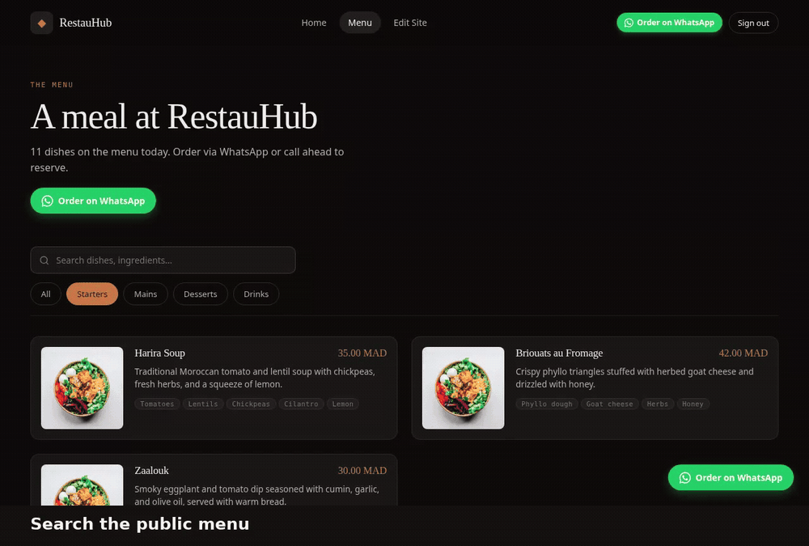

# Restaurant Website & CMS

[](https://github.com/saadallahgharnouk-alt/restaurant_saas/actions/workflows/ci.yml)

A restaurant website with a searchable menu and a manager dashboard, built with React and Express. Guests can filter dishes by category or search by ingredient. Managers can update dishes, prices, photos, and restaurant details from the dashboard.

**Stack** · React 19, Vite, React Router, Express 5, Multer, and CSS

[Download the 44-second walkthrough (MP4)](docs/restaurant-walkthrough.mp4) · [View the menu screenshot](docs/menu.webp)



## My contributions

- I built the React storefront with category filters and ingredient search.
- I built the manager dashboard for editing dishes, prices, restaurant details, and media.
- I connected the dashboard to Express for file-backed storage and added a browser-storage fallback for running the CMS locally without the API.

## Try it locally

Use Node.js 22.12 or newer.

```bash
npm ci
npm run dev
```

Open [localhost:5173](http://localhost:5173). The app starts with sample restaurant content, and the frontend can run on its own.

| Page | What to try |
| --- | --- |
| [`/`](http://localhost:5173/) | Browse the homepage, featured dishes, and restaurant details. |
| [`/menu`](http://localhost:5173/menu) | Search for a dish or ingredient and switch between categories. |
| [`/admin`](http://localhost:5173/admin) | Sign in with the local demo account (`admin` / `admin`), change a price under **Dishes**, and save. Return to the menu to see the change. |

To preview the production build locally, run `npm run build` followed by `npm run preview`.

To store edits on disk, run `npm run server` in a second terminal. The frontend uses `http://localhost:5000` by default. See [`.env.example`](.env.example) for configuration. The browser-only sign-in is intended for local demos. A public deployment would need server-side authentication and authorization for content changes and uploads.

## Run the checks

After `npm ci`, install Chromium for Playwright and run the same lint, browser tests, and build as GitHub Actions.

```bash
npx playwright install --only-shell chromium
npm run lint
npm test
npm run build
```

The browser tests cover ingredient search with category filters and verifying that a manager's edits survive a reload when the CMS API is offline.

## How it works

- One schema defines branding, landing page sections, menu categories and dishes, location, and contact details. [Content model](src/lib/content-schema.js)
- React context shares content between the public pages and the editor. The store loads from the API and falls back to browser storage or the bundled sample content. Edits made without the API stay in the current browser. [Frontend content store](src/lib/content-store.jsx)
- `GET /api/content` loads saved edits and `PUT /api/content` writes them to a JSON file. The upload endpoint accepts PNG, JPEG, and WebP files up to 2 MiB, and the upload control can embed an image as a data URL when the API is unavailable. [Express CMS API](backend/server.js) · [Upload control](src/components/MediaUpload.jsx)

See the [feature list](FEATURES.md) for details on the editor, Google Maps, and WhatsApp integration.
